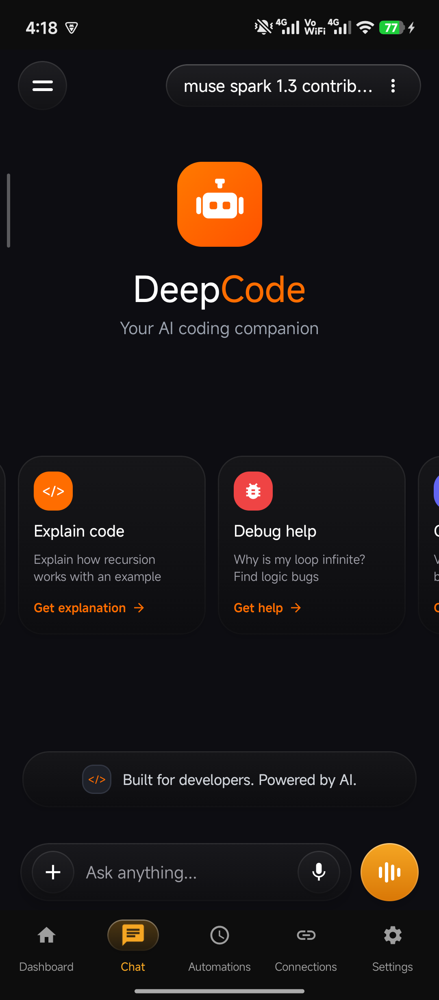
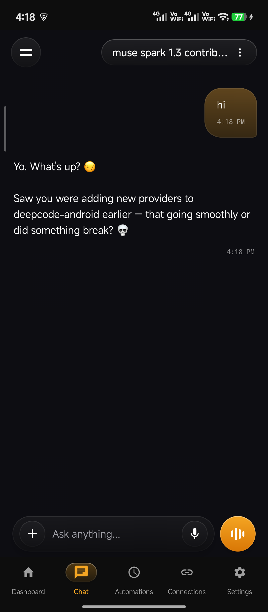

<div align="center">


# DeepCode

### Autonomous AI Agent, Rootless Linux Subsystem & Automation Studio for Android

<a href="https://git.io/typing-svg">
  
</a>

<br/>

[](https://github.com/Deep007h/DeepCode/releases/tag/v2.0.2)
[-F97316?style=for-the-badge&logo=android&logoColor=white)](https://github.com/Deep007h/DeepCode/releases/download/v2.0.2/DeepCode-v2.0.2.apk)
[-3DDC84?style=for-the-badge&logo=android&logoColor=white)](https://developer.android.com)
[](https://developer.android.com/ndk)
[](https://kotlinlang.org)
[](https://developer.android.com/jetpack/compose)
[](https://buymeacoffee.com/deep007h)
<a href="https://github.com/Deep007h/DeepCode"></a>
[](LICENSE)

<p align="center">
  <a href="#-interface-preview"><b>Interface</b></a> •
  <a href="#-whats-new-in-v202"><b>What's New</b></a> •
  <a href="#-key-features"><b>Features</b></a> •
  <a href="#-linux-subsystem--runtimes"><b>Linux Subsystem</b></a> •
  <a href="#-ai-providers--model-matrix"><b>AI Providers</b></a> •
  <a href="#-agent-tools"><b>Tools</b></a> •
  <a href="#-installation"><b>Installation</b></a> •
  <a href="#-support--buy-me-a-coffee"><b>Support</b></a>
</p>

</div>

---

## 📱 Interface Preview

<div align="center">

| 🚀 Welcome & Quick Actions | 💬 Live Streaming & Autonomous Chat |
|:---:|:---:|
|  |  |
| *Starter cards, quick prompts & neural voice entry* | *Real-time SSE streaming with autonomous tool calling* |

<br/>

<p align="center">
  <sub><b>Left</b>: Fresh session with prompt starter cards, quick coding actions, and voice waveform mode. <b>Right</b>: Active autonomous agent conversation demonstrating continuous bi-directional agent reasoning and tool execution in real-time.</sub>
</p>

</div>

---

## 🚀 Overview

**DeepCode** transforms your Android smartphone or tablet into an autonomous, desktop-grade AI software development environment. By coupling rootless Linux userspace execution (**Ubuntu 20.04 LTS via PRoot ARM64**) and autonomous agent harnesses (**DeepSeek Harness**, **Claude Code**, **Nous Research Hermes Agent**, **Google Antigravity**) with 70+ flagship AI models (**OpenCode Zen**, **Google Antigravity Gemini 3.8**, **TokenHarbor AI**, **Groq LPU**, **Ollama Cloud**, **OpenAI**, **Anthropic**), DeepCode brings true agentic autonomy directly to mobile.

Whether you need to generate multi-file codebases, execute Python/Node.js/C++ toolchains inside Linux, audit repositories, run multi-turn shell commands, compile publication-grade PDFs, or run exact background automations that wake your device on exact schedules, DeepCode executes without requiring root access.

---

## ⚡ What's New in v2.0.2

<details open>
<summary><b>✨ Highlights of Release 2.0.2 (Current)</b></summary>
<br/>

- 🍎 **Apple-Style Floating Island Dashboard & Dock**:
  - **Fluid Liquid Glassmorphism**: Custom `Modifier.appleGlassDock` with frosted translucent acrylic backing, specular refraction gradient rim (`highlightAlpha = 0.28f`), elevation drop shadow, and 32dp continuous pill geometry.
  - **Riceball Fluid Navigation**: Jitter-free sliding selection indicator covering both icon and text tab with continuous spring-interpolated transitions.
  - **Interactive Live Preview**: Instant visual preview card in **Settings > Themes & Wallpapers** for comparing Floating Island and Classic Dock styles.
  - **Adaptive Keyboard Insets**: Floating dock tracks IME keyboard elevation smoothly with comfortable floating margins above system gesture navigation bars.

- ⚡ **DeepSeek Harness & OpenCode Zen Wire Protocol Integration**:
  - **LocalFormatGateway Proxy**: On-device loopback proxy that transparently translates OpenAI `/chat/completions` and Anthropic `/messages` calls for autonomous CLI harnesses (`dsh`, `claude`).
  - **Verification Headers**: Automatically injects upstream Bun runtime `User-Agent`, `x-opencode-client: cli`, `x-opencode-project: global`, session affinity, and cloaked decoy tool definitions (`bash`, `read`) satisfying OpenCode Zen free-tier verification.
  - **Keyless Free Tier Execution**: Runs OpenCode Zen free models (`mimo-v2.5-free`, `deepseek-v4-flash-free`) out of the box without requiring manual API keys.
  - **Resilient Fallback**: If an autonomous harness encounters an environment issue, DeepCode automatically falls back to the Direct In-App Engine so queries are never left unanswered.

- 🪽 **Nous Research Hermes Runner v0.5.2 & Multi-Engine Resiliency**:
  - **Critical Process Exit Handling**: Fixed exit condition in `HermesRuntimeBridge` ensuring process errors and unhandled exceptions are caught cleanly.
  - **Multi-Endpoint Failover**: Added multi-endpoint failover (`zen/v1` and `zen/go/v1`) across free models (`mimo-v2.5-free`, `ling-3.0-flash-fin-free`, `nemotron-3-ultra-free`).

- 🧠 **Cerebras & Extended Provider Support**:
  - Unified provider alias resolution supporting both `Cerebras` and `Cerebrus` across all execution engines.

</details>

<details>
<summary><b>📜 Highlights of Release 2.0</b></summary>
<br/>

- 🪽 **Nous Research Hermes Agent Integration**:
  - Autonomous coding agent running directly inside rootless Ubuntu 20.04 LTS PRoot subsystem (`AgentKind.HERMES`).
  - Automatic toolchain bootstrap (`/usr/local/bin/hermes` and Python runner).
  - Multi-provider tool execution (OpenRouter, DeepSeek, OpenAI, Anthropic, OpenCode Zen) with autonomous `--yolo` execution loop.
  - Dedicated 6-phase progressive thinking steps in chat with Emerald Green accent badge.

- ⚡ **Autonomous Harness Agent Latency & Reliability**:
  - Direct subshell invocation eliminating nested subshell hops and reducing launch latency by ~40%.
  - Low-latency streaming buffers (`char[1024]` with immediate UI propagation) for responsive real-time token streaming.
  - Hardened SIGINT / SIGTERM handling and process group cleanup to eliminate orphan PRoot processes.

- 🎨 **ChatScreen Tactile Design System Overhaul**:
  - Convex specular bevel highlights (`Modifier.depthPill`, `highlightAlpha = 0.35f`).
  - Spring-based haptics (`bouncyClickable`) with native touch feedback.
  - Overhauled Setup Wizard, Linux Subsystem, Terminal Console, and Voice Studio.

- 🧠 **Dynamic 2-Second Thinking Engine (`AnimatedThinkingCard`)**:
  - Fluid engineering progression cycling context-aware steps every 2 seconds.
  - Tailored trajectories per agent harness (DeepSeek Harness, Claude Code, Antigravity, Hermes, Direct Engine).

- 🏷️ **Engine Attribution Badges**:
  - Clear chat indicators showing whether an answer was generated by an autonomous PRoot harness (`⚡ DeepSeek Harness`, `✳️ Claude Code`, `🚀 Antigravity`, `🪽 Hermes Agent`) or the built-in direct engine (`🤖 Direct Engine`).

</details>


---

## 🐧 Linux Subsystem & Runtimes

DeepCode features a complete, self-contained userspace **Linux Subsystem** powered by **PRoot ARM64** that runs on standard, non-rooted Android devices:

- **Rootless Ubuntu 20.04 LTS**: Boots a full Linux userspace directly within the app's private sandbox without modifying system partitions or tripping SafetyNet/Play Integrity.
- **Native C++ JNI Bridge**: High-performance process launcher (`libpocketspawn.so`, `libproot.so`, `libtalloc.so`) providing POSIX process spawning, standard I/O multiplexing, and clean signal termination.
- **Built-In Developer Toolchains**: Run Python 3, Node.js, Git, Bash, and C/C++ compilation directly on your phone.
- **LocalFormatGateway**: Integrated HTTP/SSE reverse proxy providing seamless translation between OpenAI `/chat/completions`, Anthropic `/messages`, and OpenCode Zen wire protocols.
- **Dual Terminal Studio**: Interactive terminal emulator supporting:
  - 🐧 **Ubuntu PRoot**: Rootless Linux development environment.
  - ⚡ **Root `su` Shell**: Elevated root shell (via libsu for rooted devices).
  - 📱 **Android `sh`**: Standard non-root Android shell sandbox.
  - ⌨️ Dedicated mobile programmer touch bar (Ctrl, Alt, Tab, Esc, Pipes, Directional Keys).

---

## 🌟 Key Features

- 🤖 **Streaming Agentic Loop**: Multi-turn SSE streaming with dynamic tool-calling, chain-of-thought display, and syntax-highlighted code diffs.
- 🔄 **Multi-Key Ring Auto-Rotation**: Store up to **6 API keys per provider** with silent, millisecond failover when hitting HTTP 429 rate limits or quota caps.
- 🌐 **Interactive Web Preview**: Built-in HTTP development server and live browser view for previewing web apps, HTML, CSS, and JavaScript directly inside DeepCode.
- 📝 **Integrated Sora Editor**: Fast text and code editor with syntax coloring, line numbers, search-and-replace, and undo/redo stacks.
- 📄 **Native PDF Studio**: Generate beautiful, publication-ready PDF documents across 6 specialized design templates (`classic`, `modern-minimal`, `corporate-report`, `academic-paper`, `invoice-receipt`, `resume-cv`).
- 🎙️ **Voice Studio & Neural Audio**: Real-time speech input coupled with Microsoft Edge neural TTS and Google Gemini Audio models with emotion tags (`[excited]`, `[empathetic]`, `[dramatic]`, `[professional]`).
- ⏰ **Background Automations**: Exact wakeups via Android's `AlarmManager.setExactAndAllowWhileIdle()` and `WAKE_LOCK`, executing tasks in dedicated persistent threads that survive device reboots.
- 🔒 **Hardware-Isolated Security**: All API keys, tokens, and OAuth credentials encrypted via **AES-256-GCM** backed by the hardware **Android Keystore**.


---

## 🧠 AI Providers & Model Matrix

DeepCode provides unified routing across 20+ leading AI providers. Configure your keys in **Settings → API Keys**:

| Provider | Access Type | Highlighted Models | Context | Tier |
|:---|:---|:---|:---|:---|
| **OpenCode Zen AI** | **Free Gateway / API Key**<br/>`https://opencode.ai/zen/v1` | `deepseek-v4-flash-free`<br/>`mimo-v2.5-free`<br/>`muse-spark-1.3-contributor-free`<br/>`nemotron-3-ultra-free`<br/>`ling-3.0-flash-fin-free`<br/>`gemini-3.8-flash`<br/>`claude-fable-5.1`<br/>`claude-sonnet-5`<br/>`gpt-6-astra` | 1M Tokens<br/>128k Tokens<br/>1M Tokens<br/>128k Tokens<br/>128k Tokens<br/>1M Tokens<br/>1M Tokens<br/>200k Tokens<br/>128k Tokens | **Free**<br/>**Free**<br/>**Free**<br/>**Free**<br/>**Free**<br/>Paid<br/>Paid<br/>Paid<br/>Paid |
| **Google Antigravity** | **Google OAuth 2.0 / Bearer (`ya29.`)** | `gemini-3.8-flash`<br/>`gemini-3.8-flash-cyber`<br/>`gemini-3-flash-agent`<br/>`gemini-3-pro-preview`<br/>`claude-sonnet-5` (Thinking)<br/>`claude-opus-4-6-thinking`<br/>`gpt-oss-120b-medium` | 1M Tokens<br/>1M Tokens<br/>1M Tokens<br/>1M Tokens<br/>200k Tokens<br/>200k Tokens<br/>128k Tokens | **Free**<br/>Paid<br/>**Free**<br/>Paid<br/>Paid<br/>Paid<br/>Paid |
| **TokenHarbor AI** | **API Key / Bearer Auth**<br/>`https://tokenharbor.ai/v1` | `deepseek-v4.1-flash:free`<br/>`deepseek-v3:free`<br/>`deepseek-r1:free`<br/>`meta-llama-3.3-70b-instruct:free`<br/>`gemini-2.5-flash:free`<br/>`gpt-4o-mini:free` | 128k Tokens<br/>128k Tokens<br/>128k Tokens<br/>128k Tokens<br/>1M Tokens<br/>128k Tokens | **Free**<br/>**Free**<br/>**Free**<br/>**Free**<br/>**Free**<br/>**Free** |
| **Ollama Cloud** | **API Key / Bearer Auth**<br/>`https://ollama.com/v1` | `qwen3-coder:480b`<br/>`gpt-oss:120b`<br/>`gemma4` (31B)<br/>`glm-4.7`<br/>`minimax-m3`<br/>`nemotron-3-super` (120B) | 128k Tokens<br/>128k Tokens<br/>128k Tokens<br/>128k Tokens<br/>1M Tokens<br/>128k Tokens | **Free**<br/>**Free**<br/>**Free**<br/>**Free**<br/>**Free**<br/>**Free** |
| **Google Gemini** | **Google AI Studio Key** | `gemini-3.8-flash`<br/>`gemini-2.0-flash`<br/>`gemini-2.0-flash-lite`<br/>`gemini-2.0-pro-exp-02-05`<br/>`imagen-3.0-generate-002` | 1M Tokens<br/>1M Tokens<br/>1M Tokens<br/>2M Tokens<br/>Image Gen | **Free**<br/>**Free**<br/>**Free**<br/>**Free**<br/>**Free** |
| **Groq Cloud** | **Groq API Key (LPU)** | `llama-3.3-70b-versatile`<br/>`llama-3.1-8b-instant`<br/>`deepseek-r1-distill-llama-70b`<br/>`openai/gpt-oss-120b` | 128k Tokens<br/>128k Tokens<br/>128k Tokens<br/>128k Tokens | **Free**<br/>**Free**<br/>**Free**<br/>**Free** |
| **DeepSeek Harness** | **Autonomous DSH CLI**<br/>`dsh` via Ubuntu PRoot | `deepseek-chat`<br/>`deepseek-coder`<br/>Multi-Provider CLI Execution | 128k Tokens | **Free** / Paid |
| **Nous Hermes Agent** | **Nous Research Autonomous CLI**<br/>`hermes` via Ubuntu PRoot | `hermes-3-llama-3.1-405b`<br/>`hermes-3-llama-3.1-70b` | 128k Tokens | **Free** / Paid |
| **Claude Code CLI** | **Anthropic Terminal CLI**<br/>`claude` via Ubuntu PRoot | `claude-3-7-sonnet`<br/>`claude-3-5-sonnet` | 200k Tokens | Paid |
| **OpenAI API** | **OpenAI API Key** | `gpt-6-astra`<br/>`gpt-5.6-sol`<br/>`gpt-4o`<br/>`gpt-4o-mini`<br/>`o3-mini`<br/>`dall-e-3` | 128k Tokens<br/>128k Tokens<br/>128k Tokens<br/>128k Tokens<br/>200k Tokens<br/>Image Gen | Paid<br/>Paid<br/>Paid<br/>Paid<br/>Paid<br/>Paid |
| **Anthropic** | **Anthropic API Key** | `claude-fable-5.1`<br/>`claude-opus-5`<br/>`claude-sonnet-5`<br/>`claude-3-7-sonnet-latest` | 1M Tokens<br/>200k Tokens<br/>200k Tokens<br/>200k Tokens | Paid<br/>Paid<br/>Paid<br/>Paid |
| **Cerebras / Mistral** | **Respective API Keys** | Llama 3.3 70B, DeepSeek R1, Codestral, Mixtral 8x22B | Up to 128k Tokens | Free / Paid |

---

## 🛠️ Agent Tools

The autonomous agent loop executes native tools directly on Android:

| Tool | Purpose | Description |
|:---|:---|:---|
| `create_pdf` | Document Generation | Compiles formatted PDFs using 6 design templates |
| `web_search` | Live Search | Queries web search engines and returns markdown summaries |
| `web_fetch` | Content Scraping | Fetches clean, stripped article text and documentation from any URL |
| `read_file` / `write_file` | File System I/O | Reads and writes files with atomic directory creation and UTF-8 handling |
| `list_directory` / `grep_search` | Codebase Exploration | Recursive directory exploration and regex-based multi-file search |
| `execute_command` | Shell Execution | Runs shell commands in PRoot Linux, root `su`, or Android sandbox with stdout/stderr capture |
| `edge_tts` | Speech Synthesis | Generates high-fidelity neural audio playback via WebSocket pipeline |
| `qr_generate` | Utility | Encodes text, URLs, or payloads into high-resolution PNG QR images |
| `zip_create` / `zip_extract` | Archive Management | Bundles workspaces or extracts compressed archives seamlessly |
| `csv_to_json` / `csv_create` | Structured Data | Parses and transforms delimited tabular datasets |

---

## 📦 Installation

### Option 1: Direct APK Download (Recommended)
1. Download the latest **`DeepCode-v2.0.2.apk`** from [GitHub Releases](https://github.com/Deep007h/DeepCode/releases/tag/v2.0.2).
2. Allow installation from unknown sources in Android Settings.
3. Open DeepCode and configure your preferred provider or choose a free-tier engine during the Onboarding Setup Wizard.

### Option 2: Build From Source
```bash
# 1. Clone repository
git clone https://github.com/Deep007h/DeepCode.git
cd DeepCode

# 2. Compile Debug APK with Gradle (JDK 17)
./gradlew assembleDebug

# 3. Deploy to connected Android device via ADB
adb install -r app/build/outputs/apk/debug/app-debug.apk
```

---

## ☕ Support & Buy Me a Coffee

If **DeepCode** saves you development time, powers your mobile coding workflows, or helps you run autonomous agents on Android, consider supporting ongoing open-source development!

<div align="center">

<a href="https://buymeacoffee.com/deep007h" target="_blank">
  
</a>

<br/><br/>

[](https://buymeacoffee.com/deep007h)
[](https://github.com/sponsors/Deep007h)

<p align="center">
  <sub>Your support helps fund continuous updates, PRoot runtime bundles, and new autonomous agent bridges!</sub>
</p>

</div>

---

## 🔐 Security & Privacy

- **On-Device Storage**: Code files, terminal history, workspace files, and chat conversations remain strictly stored on your device.
- **Hardware Encryption**: Sensitive credentials are encrypted with AES-256-GCM keys managed by the Android Keystore.
- **Root Protection**: Root operations require explicit superuser approval through your device's root manager (Magisk / KernelSU / APatch).

---

## 📄 License

This project is licensed under the [MIT License](LICENSE).

<div align="center">
  <sub>Built with ❤️ for the global open-source developer & AI agent community.</sub>
</div>
